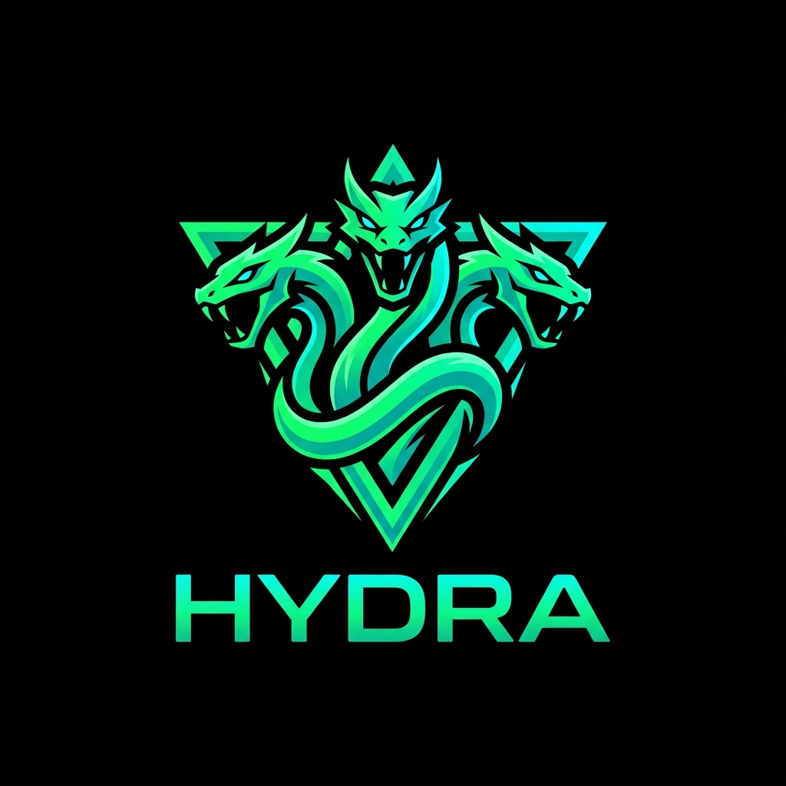
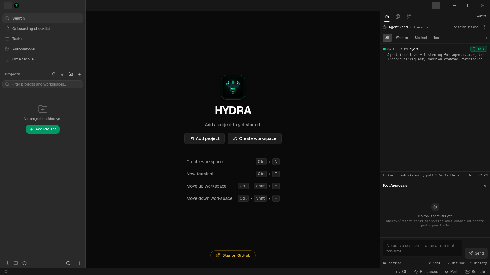

<div align="center">



# Hydra ADE

**Autonomous Development Environment for Parallel AI Agent Fleets**

[](https://github.com/renanbs/hydra/releases)
[](https://github.com/renanbs/hydra/actions/workflows/release.yml)
[](https://tauri.app/)
[](https://www.rust-lang.org/)
[](https://react.dev/)
[](https://sqlite.org/)
[](#)

</div>

---



> Screenshot real (Chromium 1248, 1600×900, `vite` preview). Sem mockups: é o app a arrancar sem projeto.

## ⚡ O que é

O **Hydra ADE** orquestra frotas de agentes de código em paralelo, cada um isolado no seu git worktree e branch. Junta a UX densa do **Orca IDE** (sidebar de frota, workbench multi-tab, command palette) com um núcleo Rust à prova de crash (PTY `portable-pty`, shadow buffer `vt100` em memória, persistência SQLite WAL): fechar o frontend nunca mata compilações ou agentes.

**Estado da paridade Orca → Hydra:** núcleo (terminal, git, worktrees, settings, SSH, updater) portado e verificado (699 capacidades mapeadas na base interna).

## 🎬 Demo (60s)

> Vídeo ainda não gravado. Roteiro: `docs/demo-script.md`. Slot: `docs/demo.mp4` (+ thumbnail `docs/demo-thumb.png`).

## 🚀 Instalação

### Via release (recomendado)

1. Baixa o `.deb`/`.rpm` em [Releases](https://github.com/renanbs/hydra/releases) e instala (`sudo apt install ./hydra_X.Y.Z_amd64.deb`).
2. Abre o Hydra → **Add Project** → **Create workspace** (`Ctrl+N`).
3. O updater embutido detecta a próxima versão sozinho (rodapé do Settings mostra `update X available`).

### A partir do fonte

```bash
git clone git@github.com:renanbs/hydra.git
cd hydra
git checkout develop        # integração estável; main = versões
pnpm install
pnpm tauri dev              # Vite + daemon Rust
pnpm tauri build            # bundle otimizado
```

Pré-requisitos Linux: Node 20+ · pnpm · Rust stable · `libwebkit2gtk-4.1-dev build-essential curl wget file libxdo-dev libssl-dev libayatana-appindicator3-dev librsvg2-dev` (Debian/Ubuntu).

## ✨ Funcionalidades (verificadas, não marketing)

| Área | O que existe hoje |
|---|---|
| Frota & worktrees | sidebar de frota, create/remove/rename, sort, `save_sidebar_pref`, detecção de PR (`pr_status`), nomes aposentados |
| Terminal | `start/resize/input/kill`, sessões persistidas, snapshot `vt100`, `send_terminal_input` |
| Git | stage/unstage/discard/commit/amend/pull/push/stash/diff/history/branch, `check_git_ignored` |
| Ficheiros | listar/ler/pesquisar/criar/renomear/apagar, clone com abort, `is_git_repository` |
| SSH | targets CRUD, `~/.ssh/config` import, probe, reconnect, host-key accept, leases, **port-forward registry** |
| Agentes | detecção (`list_available_agents`), estado decay, sync keys, keep-awake, tool approvals |
| Updater | status/check/dismiss/nudge/list builds/download/install + instruções `.deb/.rpm` (F16 10/10) |
| Settings | persistência SQLite, ghostty/warp preview, fontes, runtime envs, pairing QR |

Rails em construção: gh completo, Linear API, automations IPC, onboarding IPC, browser webview, plugins/marketplace.

## ⌨️ Atalhos

| Atalho | Ação |
|---|---|
| `Ctrl+P` | Command palette |
| `Ctrl+T` | Novo terminal |
| `Ctrl+N` | Create workspace |
| `Ctrl+Shift+↑/↓` | Mover workspace |

## 🧭 Desenvolvimento (gitflow)

- `main` — versões (tags `v*` disparam o [workflow de release](./.github/workflows/release.yml): deb+rpm assinados).
- `develop` — integração estável, sem versão.
- `feature/*`, `release/*`, `hotfix/*` — trabalho; auditorias em `hydra/*` sem merge até aprovação.

```bash
pnpm exec tsc --noEmit                                  # tipos
cargo test --manifest-path src-tauri/Cargo.toml         # Rust
pnpm exec vitest run                                    # frontend (1954 tests)
```

## 🔧 Troubleshooting

| Sintoma | Causa provável |
|---|---|
| `__TAURI_INTERNALS__` em testes | normal fora do bundle Tauri; 30 collect errors pré-existentes, 0 falhas |
| Janela sem decoração no Wayland | intencional (`decorations: false` + `start_dragging()`) |
| `no update feed` no Settings | `HYDRA_UPDATE_REPO` unset em dev; em release aponta para `renanbs/hydra` |
| Firewall/portal no SSH | usa o OpenSSH do sistema; `ssh -G` resolve o alias antes do dial |

## 📄 Licença

MIT © [Renan Biegelmeyer](https://github.com/renanbs)
