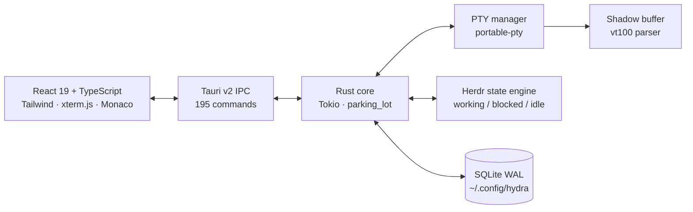

<div align="center">


# Hydra ADE

**The native runtime for parallel coding-agent fleets.**

One Rust binary. Real PTYs. Git worktrees per agent. No Electron, no Node in the loop.

[](https://github.com/renanbs/hydra/releases)
[](https://github.com/renanbs/hydra/actions/workflows/release.yml)
[](https://tauri.app/)
[](https://www.rust-lang.org/)
[](https://react.dev/)
[](https://sqlite.org/)
[](#)

</div>

---


> Real screenshot, no mockup: Hydra booting with no project open (Chromium 1248, 1600×900, `vite` preview).

## What Hydra is

Hydra is an autonomous development environment for running many coding agents at once. Every agent gets its own git worktree, branch, terminal, and state machine, all owned by a Rust core that outlives the webview. Reload or crash the UI and the work keeps running; reopen it and you reattach to the same live terminals.

It is **not** a wrapper around another agent tool. Hydra owns the PTYs, the git plumbing, the session database, and the agent-state detection. Any CLI you already use — Claude Code, Codex, Cursor, OpenCode, Goose, Gemini, OMP, plain bash — runs unmodified inside it.

- **Fleet-first, not file-first** — worktrees and agent sessions are the primary objects; files are a side panel.
- **Detach-proof** — PTYs live in Rust, not in the webview. A frontend reload or crash never kills an agent.
- **State you can trust** — Herdr-style `working` / `blocked` / `idle` detection from real terminal output.
- **Local and deterministic** — zero external AI SDKs ship in the binary. No cloud dependency for the runtime.
- **Orca-grade ergonomics** — dense sidebar, multi-tab workbench, command palette, Monaco diffs, xterm.js terminals.

## Why a Rust core

The interesting engineering is not the React shell; it is what survives when the shell dies.

| Guarantee | Mechanism |
|---|---|
| Frontend reload cannot kill an agent | PTY processes are spawned and owned by Rust (`portable-pty`); the webview is a viewer. |
| Clean text for prompts without re-parsing | Every session keeps an in-memory `vt100` shadow buffer. Clean text comes from `screen().contents()`, ANSI from `contents_formatted()`, folded by `fold_terminal_output`. |
| No GTK main-thread stalls | Every I/O, IPC, or DB-backed `#[tauri::command]` is `async`; blocking work moves to `spawn_blocking`. |
| Terminology stays correct under load | The PTY reader loop does zero allocations and zero SQLite queries per output chunk; output is pushed to the UI via events, never polled. |
| Bounded IPC | Local sockets use 300 ms read/write timeouts; agent state is derived in Rust, not in JavaScript. |
| Crash recovery | Sessions, worktrees, SSH state, and settings persist in SQLite WAL under `~/.config/hydra/`. |
| One artifact | Tauri v2 embeds the frontend in the native binary. No Electron runtime, no Node process. |

**195 Tauri commands** across PTY, git, worktrees, files, SSH, agents, updater, settings, and runtime inspection form the core's public surface. The runtime contains no LLM SDK and no decision engine: agent state is derived deterministically in Rust.



## Features

Verified against the current IPC surface, not a roadmap:

| Area | What ships today |
|---|---|
| Fleet & worktrees | Fleet sidebar; create/remove/rename; ordering; `save_sidebar_pref`; PR status per worktree; retired workspace names; numeric worktree jump. |
| Terminal | `start`/`resize`/`input`/`kill`; persisted sessions; `vt100` snapshots; `send_terminal_input`; scrollback search; image and ligature addons; WebGL renderer. |
| Git | Stage/unstage/discard, commit/amend, pull/push, stash, diff, history, branch operations, ignored-file checks. |
| Files | List, read, search, create, rename, delete; abortable clone; git-repository detection. |
| Agents | Auto-detection of installed CLIs; state decay; sync keys; keep-awake; human-in-the-loop tool approvals (approve/reject). |
| SSH | Target CRUD; `~/.ssh/config` import; probe; reconnect; host-key acceptance; leases; persistent **port-forward registry**. Remote PTYs run over the system OpenSSH client. |
| Updater | Status, check, dismiss, nudge, build listing, download/install, plus `.deb`/`.rpm` instructions. |
| Settings | SQLite-backed preferences; terminal previews; fonts; runtime envs; pairing QR. |

Detected agent CLIs: **Claude Code · Codex CLI · Cursor CLI · Oh My Pi (OMP) · OpenCode · Goose · Gemini CLI · plain bash**. Detection is a `PATH` probe (`list_available_agents`); Hydra does not wrap or reimplement them.

**Deliberately not wired yet:** full GitHub CLI surface, Linear API, automations IPC, onboarding IPC, embedded browser webview, plugins/marketplace, remote workspace relay daemon.

## Install

### Packages

Download from [Releases](https://github.com/renanbs/hydra/releases):

```bash
sudo apt install ./hydra_X.Y.Z_amd64.deb     # Debian / Ubuntu
sudo dnf install ./hydra-X.Y.Z-1.x86_64.rpm  # Fedora / RHEL
```

Use the `.AppImage` on other distributions. Arch users get the stable source package from the AUR as `hydra-ade`. Installed releases self-update (Settings shows `update X available`); builds from source do not.

### From source

```bash
git clone git@github.com:renanbs/hydra.git
cd hydra
git checkout develop        # stable integration; main carries releases
pnpm install
pnpm tauri dev              # Vite + native core
pnpm tauri build            # optimized bundle
```

**Requirements:** Node 20+ (CI uses 22), pnpm, Rust stable, and the Tauri Linux stack:

```bash
sudo apt install libwebkit2gtk-4.1-dev libappindicator3-dev librsvg2-dev \
  patchelf xdg-utils build-essential curl wget file libssl-dev
```

## Quick start

1. **Add project** — point Hydra at a repository.
2. **Create workspace** — `Ctrl+N`; Hydra cuts a worktree and branch.
3. **Spawn an agent** — open a terminal tab (`Ctrl+T`) and run your CLI of choice.
4. **Watch the fleet** — the sidebar marks each session `working`, `blocked`, or `idle`.
5. **Approve, don't babysit** — blocked tool calls surface as cards; `Ctrl+Enter` approves, `Esc` rejects.

## Keyboard shortcuts

| Shortcut | Action |
|---|---|
| `Ctrl+P` | Command palette |
| `Ctrl+J` | Jump palette |
| `Ctrl+N` | Create workspace |
| `Ctrl+T` | New terminal tab |
| `Ctrl+W` | Close focused tab |
| `Ctrl+B` | Toggle fleet sidebar |
| `Ctrl+Shift+J` | Toggle agent panel |
| `Ctrl+,` | Settings |
| `Ctrl+Tab` / `Ctrl+Shift+Tab` | Cycle recent tabs |
| `Ctrl+Shift+C` / `Ctrl+Shift+V` | Copy / paste in terminal |
| `Ctrl+L` | Clear terminal screen |
| `Ctrl+Enter` / `Esc` | Approve / reject pending tool execution |

Bindings in Settings → Shortcuts are remappable; the sidebar and panel toggles dispatch through the keybinding registry.

## Development

Gitflow:

- `main` — releases. A `v*` tag runs the [release workflow](./.github/workflows/release.yml): `.deb`, `.rpm`, AppImage, updater signatures, and the AUR package.
- `develop` — stable integration, no version bump.
- `feature/*`, `release/*`, `hotfix/*` — feature work. `hydra/*` audit branches stay unmerged until approved.

```bash
pnpm exec tsc --noEmit                                  # types
pnpm exec vitest run                                    # frontend tests
cargo test --manifest-path src-tauri/Cargo.toml         # Rust tests
pnpm build                                              # tsc + vite production build
```

Design constraints that are non-negotiable in review: PTY output always passes through the `vt100` shadow buffer, non-async mutexes use `parking_lot`, commands touching I/O are `async`, and the window stays `decorations: false` with `start_dragging()` on Wayland.

## Troubleshooting

| Symptom | Cause |
|---|---|
| `__TAURI_INTERNALS__` in tests | Expected outside the Tauri bundle; pre-existing collect errors, no test failures. |
| Undecorated window on Wayland | Intentional: custom titlebar with `start_dragging()` and `StartupWMClass=hydra`. |
| `no update feed` in Settings | `HYDRA_UPDATE_REPO` is unset in dev; release builds point at `renanbs/hydra`. |
| SSH prompts for a firewall/portal | Hydra delegates to system OpenSSH; `ssh -G` resolves the alias before dialing. |
| Agent not listed | Detection is a `PATH` probe — start Hydra from a shell that can resolve the binary. |

## License

MIT © [Renan Biegelmeyer](https://github.com/renanbs)
